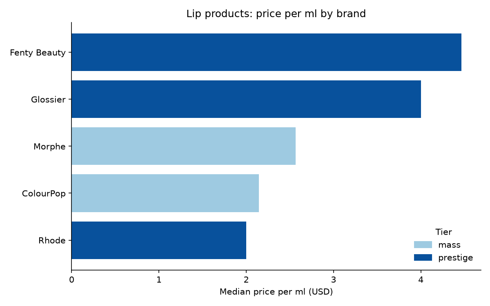

# Beauty Market Snapshot: DTC brand pricing

A snapshot of the public product catalogs of 7 direct-to-consumer beauty brands on Shopify, used to compare pricing between mass and prestige brands, price per ml, and discounting. Scraped on 2026-11-20.



## Key findings

1. **Prestige costs more than mass across categories:** the median prestige variant costs ~2× the median mass variant, with the widest gap in face category.
2. **Retail channel mostly predicts price per ml, with one exception:** for lip products, Fenty Beauty (~$4.45/ml) and Glossier (~$4.00/ml) are the most expensive per ml, but Rhode, a prestige brand, is the cheapest (~$2.00/ml), below both mass brands.
3. **Discounting is brand-specific, not tier-specific:** Morphe has ~95% of its catalog on sale, while every other brand is at 15% or below. Rhode and Frank Body have nothing on sale.

Full analysis: [`notebooks/analysis.ipynb`](notebooks/analysis.ipynb)

## Run it

Requires [uv](https://docs.astral.sh/uv/).

```bash
git clone https://github.com/<your-username>/beauty-market-snapshot.git
cd beauty-market-snapshot
uv run main.py                 # scrape, clean and load SQLite (a few minutes)
uv run jupyter lab             # open notebooks/analysis.ipynb
```

Outputs:
- `data/market.db`: SQLite database with `snapshots`, `brands` and `variants` tables
- `data/variants_latest.csv`: the latest cleaned snapshot as a CSV
- `data/raw/<timestamp>/`: the raw JSON from each run

Re-clean without scraping again: `uv run main.py --skip-scrape`

## How it works

```
tools/candidates.csv ──► tools/vet_stores.py ──► tools/vetting_results.csv
                                                        │  
                                                        ▼
                                                   stores.csv
                                                        │
main.py:  fetch.py ──► data/raw/<timestamp>/*.json ──► clean.py ──► DataFrame ──► store.py ──► data/market.db
                                                                                                    │
                                                                         notebooks/analysis.ipynb ◄─┘
```

1. **Vet:** `tools/vet_stores.py` checks each candidate brand's platform, its public product feed and robots.txt, and records whether it is sold at Sephora (answered by hand).
2. **Approve:** I read each brand's terms and promote the brands that pass into `stores.csv`, the only list the scraper reads.
3. **Scrape:** `scraper/fetch.py` re-checks robots.txt, pages through each brand's `/products.json` and saves every page untouched.
4. **Clean:** `scraper/clean.py` flattens the JSON to one row per variant and adds size, price per ml, discount and category.
5. **Store:** `scraper/store.py` writes the cleaned DataFrame into SQLite as a new snapshot.
6. **Analyse:** the notebook queries SQLite for the findings and charts.

`main.py` connects steps 3 to 5: `clean.py` returns a DataFrame and `main.py` passes it to `store.py`, so neither module depends on the other.

## Route chosen, and why

| Option | Verdict |
| --- | --- |
| TikTok Shop (original idea) | Rejected: its Terms of Service prohibit automated extraction without written approval, and it uses CAPTCHAs. |
| Sephora | Not scraped: its Terms of Use prohibit scraping and data mining. Only used as a manual lookup for tier. |
| HTML scraping with Playwright | Not needed: slower, and breaks when a site's design changes. |
| Shopify `/products.json` | **Chosen:** a public JSON endpoint that Shopify storefronts expose. Structured data, no browser needed. |

I found the endpoint by watching the Network tab in browser DevTools. `tools/find_json_routes.py` automates that discovery for sites that aren't on Shopify, but it isn't used by the pipeline.

## Brand selection

| Brand | Tier | Included |
| --- | --- | --- |
| ColourPop | mass | yes |
| Morphe | mass | yes |
| Frank Body | mass | yes |
| Fenty Beauty | prestige | yes |
| Glossier | prestige | yes |
| Kylie Cosmetics | prestige | yes |
| Rhode | prestige | yes |
| Florence by Mills | n/a | no: its product feed returns no products |

- **Tier = retail channel, not price:** prestige if sold at Sephora or a department store, mass otherwise. This follows the channel-based split the beauty industry uses, and avoids a circular definition (if tier came from price, "prestige costs more" would be true by definition).
- **Evidence:** every brand's checks, robots.txt result and terms note are in `stores.csv` and `tools/vetting_results.csv`, dated 2026-11-20.

## Design choices

- **Splitting the automated checks from my decision:** scripts gather evidence, I approve the brand list, and the pipeline only scrapes what I approved.
- **Polite scraping:** robots.txt is checked on every run, requests are spaced out with random delays, an honest User-Agent includes a contact email, and only temporary errors (429 and 5xx) are retried, with growing waits between attempts.
- **Failures stay contained:** one broken brand is logged and skipped, and the rest of the run continues.
- **Raw data kept:** every page is saved as raw JSON before cleaning, so cleaning can be changed and re-run offline with `--skip-scrape`, without contacting the sites again.
- **Snapshots:** each run is stored with its own timestamp instead of overwriting the last, so price changes can be tracked over time. Rerunning on the same raw folder replaces that snapshot rather than duplicating it.
- **One row per variant:** prices belong to variants (shades, sizes), not products, so each variant is its own row.
- **A tier definition that isn't circular:** tier comes from retail channel (sold at Sephora or not), not price, so "prestige costs more" is a real finding rather than true by definition.
- **Being open about data quality:** a `size_source` column records where each size came from, and the limitations section states what the data can't show.

## Data dictionary (`variants` table)

| Column | Meaning |
| --- | --- |
| `brand`, `product_title`, `variant_title` | Brand, product and variant (shade or size) names |
| `category` | lips, eyes, face, skincare, body, hair, fragrance, tools or other (keyword rules) |
| `price` | Current variant price, USD |
| `compare_at_price` | "Was" price set by the brand; empty if not on sale |
| `on_sale`, `discount_pct` | On sale when `compare_at_price` > `price`; discount = (1 − price ÷ compare_at_price) × 100 |
| `size_value`, `size_unit` | Size converted to ml or g |
| `size_source` | Where the size was found: variant title, product title or description |
| `unit_price` | price ÷ size_value (USD per ml or per g) |
| `available` | In stock at scrape time |

## Repository structure

```
beauty-market-snapshot/
├── main.py                  # the one command
├── stores.csv               # approved brand list the scraper reads
├── pyproject.toml, uv.lock  # dependencies (managed by uv)
├── scraper/
│   ├── fetch.py             # download raw JSON (robots check, retries, delays, logging)
│   ├── clean.py             # pandas cleaning
│   └── store.py             # SQLite schema and loading
├── tools/                   # one-off helpers, not run by main.py
│   ├── candidates.csv
│   ├── vet_stores.py
│   ├── vetting_results.csv
│   └── find_json_routes.py
├── notebooks/analysis.ipynb
└── charts/
```

## Limitations

- **One snapshot (2026-11-20):** taken a week before Black Friday, so discount levels may be higher than usual. This can be overcomed by rescraping product data.
- **Small sample:** 7 Shopify brands (3 mass, 4 prestige). Results describe these brands, not the whole beauty market, and exclude retailers like Sephora and Ulta.
- **Binary tier:** retail channel can't capture brands positioned between mass and prestige.

